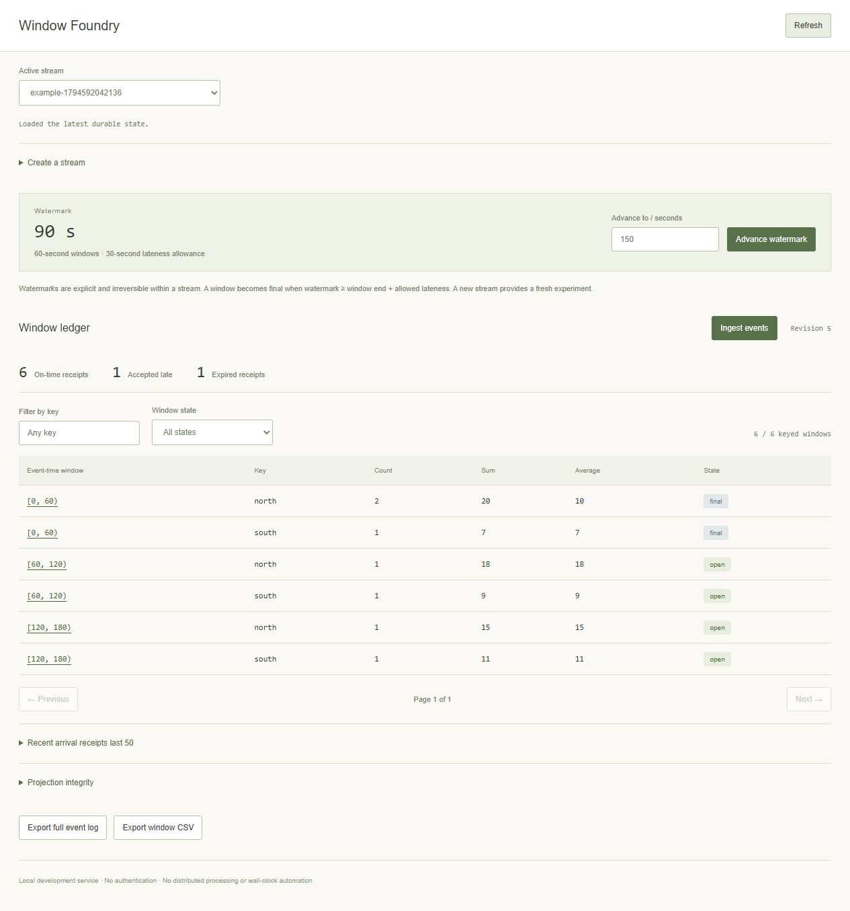

# Window Foundry

A persistent event-time analytics workbench. Ingest out-of-order events into fixed windows, advance an explicit watermark, accept arrivals during the lateness allowance, and retain expired-event receipts without changing finalized aggregates.



The main workspace centers on the watermark and window ledger. Ingest events opens a dialog for individual events, atomic batches, and retry receipts. Filters, aggregate inspection, and projection checks remain beside the ledger.

## Run

Python 3.10+ and a modern browser are sufficient. No Python dependencies or external services are required. Node 22+ is used only for the JavaScript syntax check.

```sh
python run.py --port 8000
```

Open http://127.0.0.1:8000. The default database is `data/windows.sqlite3`, which is ignored by Git. A fresh checkout starts empty. Choose **Create example stream** for six fictional readings, or create a named stream with your own fixed window width and allowed lateness.

For a separate store:

```sh
python run.py --port 8001 --db data/another-study.sqlite3
```

## Try the late-arrival workflow

1. Create the example: 60-second windows and a 30-second lateness allowance.
2. Advance the watermark to 60. The `[0,60)` windows enter grace.
3. Ingest a new event at time 15 with value 8 and key `north`. It is accepted as late; north's first-window total changes from 12 to 20.
4. Retry the last batch. The original receipt is returned and the total stays 20.
5. Advance to 90. The first windows become final. A new event at time 15 is retained as expired and does not alter the aggregate.
6. Import [the example batch](docs/example-batch.json), review it, then ingest. At watermark 90 it produces one accepted-late, one expired, and one on-time receipt.
7. Inspect a window, filter by key/state, check the projection, and export receipts or the window CSV.

[Example log](docs/example-log.json) records the verified workflow: 11 unique receipts, two watermark advances, and seven keyed windows. It contains no runtime database or private data. Full-log export is evidence for inspection/replay; the batch importer expects an event array and does not restore an exported log.

## Precise time semantics

Times are nonnegative integer seconds in a user-chosen timeline; the example starts at zero. There is no wall-clock automation. For width `W`, an event at `t` belongs to `[floor(t/W)*W, floor(t/W)*W+W)`. Every stream starts with watermark zero.

- A window is **open** while `watermark < end`.
- It is in **grace** when `end <= watermark < end + allowed_lateness`.
- It is **final** when `watermark >= end + allowed_lateness`.
- A new event for a final window is recorded as `expired` and contributes nothing.
- Otherwise, an event with `event_time < current_watermark` is recorded as `late`; all other accepted events are `on-time`.

The `late` label describes being behind the watermark, so a late event can still belong to an open window. Exact expiration uses `>=`; with zero allowance, grace has zero duration. The watermark never moves backward, and window settings never change within a stream. Create a new stream to test another policy.

This is a small explicit model inspired by event-time processing concepts, not an Apache Beam runner. [Beam's programming guide](https://beam.apache.org/documentation/programming-guide/#watermarks-and-late-data) provides broader background on watermarks, lateness, and triggers.

## Durable ingestion and recovery

An atomic batch contains 1–200 events. Each event has `id`, `key`, `time`, and `value`. IDs are scoped to a stream. A retry with the same normalized payload returns the original sequence, disposition, and arrival watermark—even if that window has since become final. A reused ID with different contents rejects and rolls back the entire batch, including earlier new events in that batch.

SQLite `BEGIN IMMEDIATE` serializes writes. The receipt, aggregate update, and stream revision commit together. Concurrent retries have one aggregate effect. This is idempotent ingestion within this database, not a claim of exactly-once delivery across distributed systems. Numeric values are normalized to binary64 before payload comparison and aggregation.

Accepted windows keep count, sum, mean, minimum, maximum, and accepted-late count. The event ledger also retains expired receipts and the watermark observed at arrival. Watermark changes use an expected-current-watermark check to reject stale writers and have their own durable history. Repeating an unchanged watermark creates no new history entry.

The projection audit recomputes accepted aggregates in receipt order and checks stored disposition/window boundaries. Rebuild replaces only derived window rows, in a transaction; it preserves receipts and watermark history. This is consistency checking, not tamper authentication. Binary64 sums have normal floating-point rounding behavior.

To back up the store, stop the server and copy the database and any remaining SQLite sidecar files together, or use SQLite's backup API. No deletion, retention eviction, or log import is exposed. A new database file starts a clean study.

## REST API

All mutation bodies use JSON. The server binds to loopback, rejects foreign Host/Origin headers, and serves only explicit assets/API routes. It is an unauthenticated local development service, not a production deployment.

| Method | Path | Purpose |
| --- | --- | --- |
| GET | `/api/streams` | List stream configurations |
| POST | `/api/streams` | Create `{name,width,lateness}` |
| GET | `/api/streams/{name}` | Consistent snapshot of aggregates, counts, and latest 50 receipts |
| POST | `/api/streams/{name}/events` | Atomic `{events:[...]}` ingestion |
| POST | `/api/streams/{name}/watermark` | Advance `{watermark,expected_watermark}` |
| GET | `/api/streams/{name}/export` | Full receipts and watermark history |
| GET | `/api/streams/{name}/audit` | Compare projection with receipts |
| POST | `/api/streams/{name}/rebuild` | Repair projection with `{}` |

For example, an ingestion body is:

```json
{"events":[{"id":"reading-001","key":"north","time":75,"value":12.5}]}
```

Conflicting IDs/stale watermarks return 409; missing streams return 404; invalid inputs return 400. Body size is limited to 64 KB. The UI stages imported batches for review before posting them. Window CSV exports the displayed snapshot; full-log export reads a fresh consistent database transaction.

## Bounds

Up to 20 streams per database; 10,000 distinct receipts and 10,000 watermark advances per stream. Window width 1–3,600 seconds; allowed lateness 0–3,600 seconds; event times/watermarks 0–2^40. Values must be finite and within ±1e9. Stream names, event IDs, and keys use 1–64 ASCII letters/digits/dot/underscore/colon/hyphen, starting with a letter or digit. Boolean numbers, unknown fields, nonfinite values, and ambiguous IDs are rejected. Each window table page shows 50 rows; filters apply to all stored windows.

There is no automatic watermark estimation, distributed partition coordination, streaming transport, session/sliding windows, or wall-clock scheduling. The model is intentionally fixed-window, single-store, and explicit.

## Verification

```sh
python -m unittest discover -s tests -v
npm run check
```

Fifteen Python tests cover half-open boundaries, grace/exact expiration, event-level lateness, restart persistence, duplicate batches, conflicting-ID rollback, twelve concurrent retries, monotonic/stale watermark checks, expired receipts, projection repair, injected SQL failure rollback, validation, isolation, and HTTP boundaries. A 500-event out-of-order experiment compares every aggregate and disposition with an independent reference. CI runs Python 3.11/3.13 on Linux and Windows plus the JavaScript syntax check.

Browser checks exercised the complete late/expired/retry workflow, conflicting atomic batch, staged JSON import, filters, window inspection, projection audit, both exports, and persistence after reload. An independent Python replay verified all 11 downloaded receipts, both watermark transitions, all seven CSV aggregates/states, and the absence of the rolled-back event.

`store.py` owns validation and transactions; `run.py` provides the HTTP boundary; `app.js` renders safe DOM text and coordinates mutations. The interface includes keyboard controls, restrained motion, and reduced-motion support.
